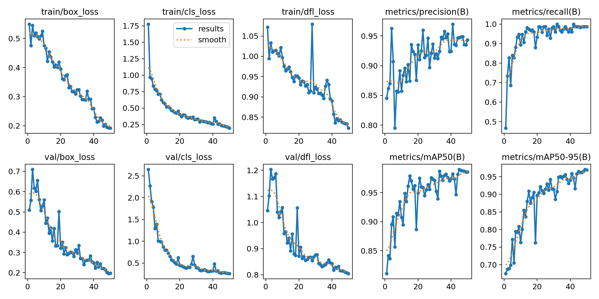
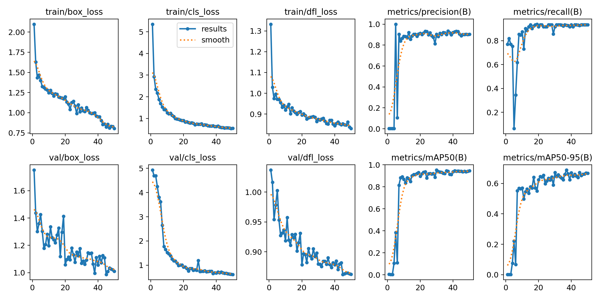

# card-scanner

Detects a Yu-Gi-Oh! card in a photo or webcam frame, locates the printed
**set number** (e.g. `RA01-EN057`), and reads it with OCR. The set number is
the lookup key used by the Yu-Gi-Oh-Scanner-Backend to fetch
full card data for the Yu-Gi-OH-Scanner-Frontend.

This repo is the computer-vision / OCR pipeline only, exposed as a standalone
FastAPI service.

## Results

| approach | exact match (42 val crops) |
|---|---|
| raw pytesseract | 2% |
| raw EasyOCR | 5% |
| **this pipeline** | **69%** |

The set-number text is only a few pixels tall after cropping, which is why
both OCR engines fail outright on it without help. See [How it works](#how-it-works)
for what actually closes that gap.

**Detection quality:**

| model | classes | mAP50 |
|---|---|---|
| `card_detector_v13` | card | 0.99 |
| `card_number_detector` | card_number | 0.95 |
| combined 2-class model | card + card_number | 0.69 |

The dedicated single-class detectors are meaningfully stronger than the
combined model, so the live pipeline runs them in series (detect card -> crop ->
detect number -> crop) rather than using the combined model.

<p float="left">
  
  
</p>

## How it works

**1. Detection - YOLOv8**, fine-tuned from `yolov8n.pt`. Two single-class
detectors (card, card_number) run in series, each cropping the region the
next stage needs.

**2. OCR - four approaches tried** none of them
alone are the answer:

1. **pytesseract** - fixed heuristic crop, grayscale -> Otsu -> 2× upscale.
2. **EasyOCR**, light preprocessing.
3. **EasyOCR**, heavy preprocessing - 4× upscale, CLAHE, adaptive threshold,
   morphological close.
4. **Custom CRNN** (CNN + 2-layer BiLSTM + CTC loss), trained on the number
   crops directly. Training script only, not yet production-ready - too
   little labeled data (206 crops) to trust its weights over the methods below.

**3. The part that actually closes the gap - closed-vocabulary correction.**
Every real set number is one of ~205k known codes. Instead of trusting a
single OCR reading, `recognize_card_number.py` runs multiple preprocessing
variants through multiple engines, then snaps each reading to the *nearest
real code* using an edit distance where OCR-confusable character swaps
(`0/O`, `1/I`, `5/S`, `2/Z`, `8/B`) cost less than a random error. Readings
vote, weighted toward matches with lexicon support - a lone unsupported guess
isn't treated as confident just because nothing else was tried.

This is the difference between 2–5% (bare OCR) and 69% (the full pipeline):
the three independent signals available - expected scale, expected character
class per position, and a closed vocabulary - do the work that the OCR engine
alone can't.

## What's still unsolved

- 9 of 42 validation crops are declined outright, 4 are read wrong.
- No perspective correction yet - an angled card distorts the glyphs before
  OCR ever sees them.
- The CRNN needs more (and cleaner) labeled crops before it can replace the
  general-purpose OCR engines.
- Next things worth trying: higher-resolution capture, deskew/perspective
  warp before cropping, super-resolution on the crop, a larger YOLO backbone
  for tighter number boxes.

## API

FastAPI + Uvicorn (`app.py`):

- `POST /scan-card` - image -> `{ "number": "<reading>" }`
- `POST /annotate-card` - image -> raw YOLO detections (card + card_number boxes)
- `GET /` - health check

## Running it

```bash
pip install -r requirements.txt
# Tesseract itself must also be installed separately and on PATH -
# see the note at the bottom of requirements.txt
uvicorn app:app --reload
```

Rebuild the lexicon: `python build_lexicon.py`.
Score changes against the validation set: `python eval_recognizer.py --show`.

## Project structure

- `app.py` - FastAPI entrypoint
- `detect_card.py` - YOLO inference wrapper
- `recognize_card_number.py` / `scan_pipeline.py` - the full recognition
  pipeline described above; this is what the API actually serves
- `ocr_card_number_recognizer.py` - CRNN training script
- `crop_card_numbers.py`, `build_lexicon.py`, `eval_recognizer.py` - data/lexicon
  tooling and the validation harness
- `live_card_detection.py`, `live_card_detection_v2.py` - webcam demos
- `helper_functions/` - dataset labeling and train/val split tooling

Trained weights and the full training dataset aren't committed here (see
`.gitignore`) - they're regenerable via the scripts above. A small set of
result plots is kept under `docs/results/` as evidence of the numbers quoted
above.
